<div align="center">
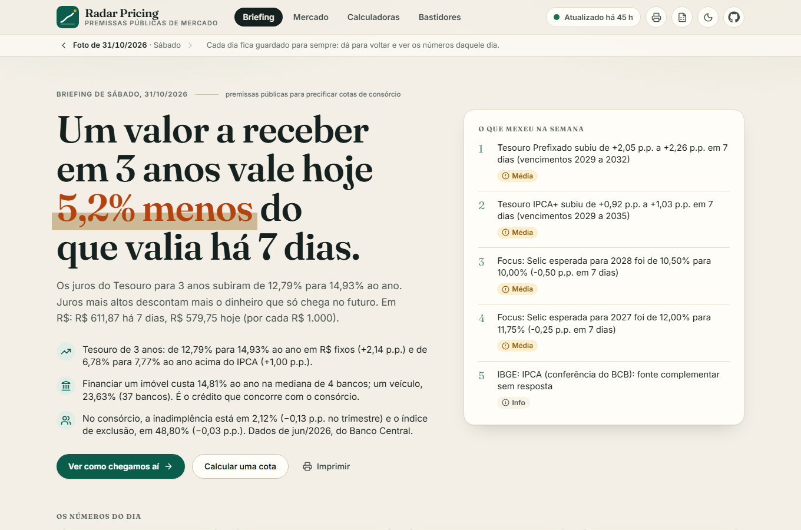
</div>

<div align="center">

# 📈 Radar Pricing

**Robô diário e gratuito que lê as premissas públicas de mercado de que o preço de uma cota de consórcio depende
(juros, crédito concorrente e setor), guarda uma foto datada de cada dia e conta o que mudou num painel público.**
Python + GitHub Actions + React, sem servidor e a custo zero.

[](https://victor-ozores.github.io/Radar-Pricing/)

&nbsp;

[](https://github.com/victor-ozores/Radar-Pricing)&nbsp;&nbsp;&nbsp;[](./LICENSE)&nbsp;&nbsp;&nbsp;

&nbsp;

[](https://github.com/victor-ozores/Radar-Pricing/actions/workflows/ci.yml)&nbsp;&nbsp;[](https://github.com/victor-ozores/Radar-Pricing/actions/workflows/coleta-diaria.yml)&nbsp;&nbsp;[](https://github.com/victor-ozores/Radar-Pricing/actions/workflows/pages.yml)

&nbsp;

[](https://app.xperiun.com/in/victor-ozores-2)&nbsp;&nbsp;&nbsp;[](https://github.com/victor-ozores)

</div>

---

## 📌 Resumo

Para precificar uma cota de consórcio, não basta olhar a cota: o preço depende de **quanto custa o dinheiro** (a Selic e os juros do Tesouro), de **quanto custa o crédito concorrente** (o financiamento de um carro ou de um imóvel) e de **como anda o setor** (cotas excluídas, inadimplência). Esses números são públicos, mas estão espalhados em várias fontes oficiais e mudam todo dia.

O Radar Pricing junta tudo: um robô lê as fontes oficiais todo dia útil, calcula o que mudou e guarda uma **foto datada** do dia, que nunca é reescrita. Um painel mostra a foto mais nova como uma história (o que aconteceu, de onde vem e quanto pesa no valor de um crédito a receber), com tabelas completas, cinco calculadoras e uma área que diz se o robô está funcionando. Construí o projeto para mostrar uma automação agendada de ponta a ponta, que roda sozinha, **avisa quando para** e deixa cada número conferível.

**Resultado da primeira coleta na nuvem (31/10/2026):** 1.236 registros de 6 das 7 fontes (a do IBGE não responde a partir dos servidores do GitHub e é só conferência), 9 mudanças do dia marcadas, status do dia **ok**, em 1 min 7 s. O número que abre o painel nesse dia: **um valor a receber em 3 anos valia 5,2% menos que 7 dias antes**, porque os juros do Tesouro para 3 anos subiram de 12,79% para 14,93% ao ano em uma semana. Conferi esse número contra o arquivo oficial do Tesouro, linha por linha. A primeira rodada agendada é a de segunda-feira, 02/11/2026.

> **É um projeto de portfólio, independente, sem vínculo com nenhuma empresa, e usa só dados públicos.** O *spread de risco* (5 p.p.) e os valores que já vêm preenchidos nas calculadoras são **de demonstração**: nenhuma empresa usa esses números, e o painel não diz o preço de uma cota nem recomenda comprar ou vender.

## 🔗 Ver o Painel Online

[](https://victor-ozores.github.io/Radar-Pricing/)

Abre direto, sem login e sem servidor: a página lê a foto do dia direto do GitHub.

---

## 💡 O Que Ele Responde

* **O que aconteceu hoje, em uma frase?** A manchete diz quanto mudou, em 7 dias, o valor de hoje de um dinheiro que só chega em 3 anos.
* **De onde vem isso?** Cinco capítulos contam a história na ordem em que o preço se forma: o custo do dinheiro, a curva de juros do Tesouro, quanto isso pesa no valor, o crédito que concorre e o setor.
* **E se a taxa andar?** Uma tabela mostra o valor de hoje em cada prazo se a taxa subir ou cair até 3 pontos.
* **Quanto vale, ou quanto rende, esta cota?** Cinco calculadoras: cota cancelada, cota ativa, retorno de uma oferta, precatório e uma lista de várias cotas de uma vez, cada uma com a conta escrita com os números e com um quadro que diz, em verde, amarelo ou vermelho, se o negócio **compensa**, quanto você lucra em reais e quanto sobra ou falta sobre o retorno que você exige.
* **Dá para confiar nos números?** O painel diz se o robô está em dia (as últimas 14 rodadas), de onde vem cada número, com a data, e o que cada termo técnico quer dizer.

## 🧭 Como Usar

| Quero... | Como |
|---|---|
| **Entender o dia em 1 minuto** | Abra o [painel](https://victor-ozores.github.io/Radar-Pricing/) na tela **Briefing** e leia a manchete e os títulos dos cinco capítulos. Cada título já diz a conclusão. |
| **Levar para uma reunião** | No Briefing, clique em **Imprimir** (ou no ícone da impressora) para imprimir ou salvar em PDF; o estilo de impressão tira os menus e usa preto sobre branco. |
| **Ver os números completos** | Tela **Mercado**: o Tesouro vencimento a vencimento, Selic, CDI, IPCA e Focus, o crédito de cada banco e as 125 métricas do setor. As tabelas ordenam, buscam e baixam em CSV. |
| **Fazer uma conta** | Botão **Calcular** no topo (no celular, a barra de baixo): ele abre direto a calculadora que você usou por último, e os campos lembram o que você digitou neste navegador. Mude o *spread de risco* e tudo se refaz, no painel inteiro; o painel lembra o seu valor neste navegador. |
| **Voltar a um dia anterior** | As setas ao lado da data, no topo. Cada dia fica guardado para sempre, então dá para ver os números daquele dia. |
| **Abrir no Excel** | O botão da planilha, no topo, gera na hora um arquivo de 15 abas, com fórmulas de verdade. |
| **Saber se o robô travou** | Tela **Bastidores → O robô travou?**, ou o selo verde, amarelo ou vermelho no topo de toda página. |

## 🖼️ Preview

<div align="center">
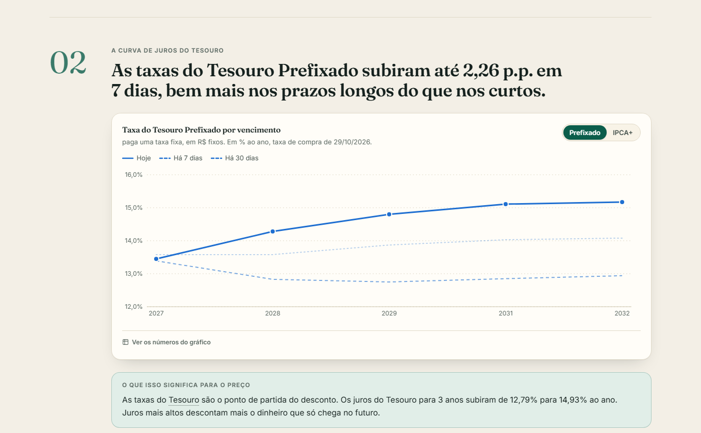
<br><br>
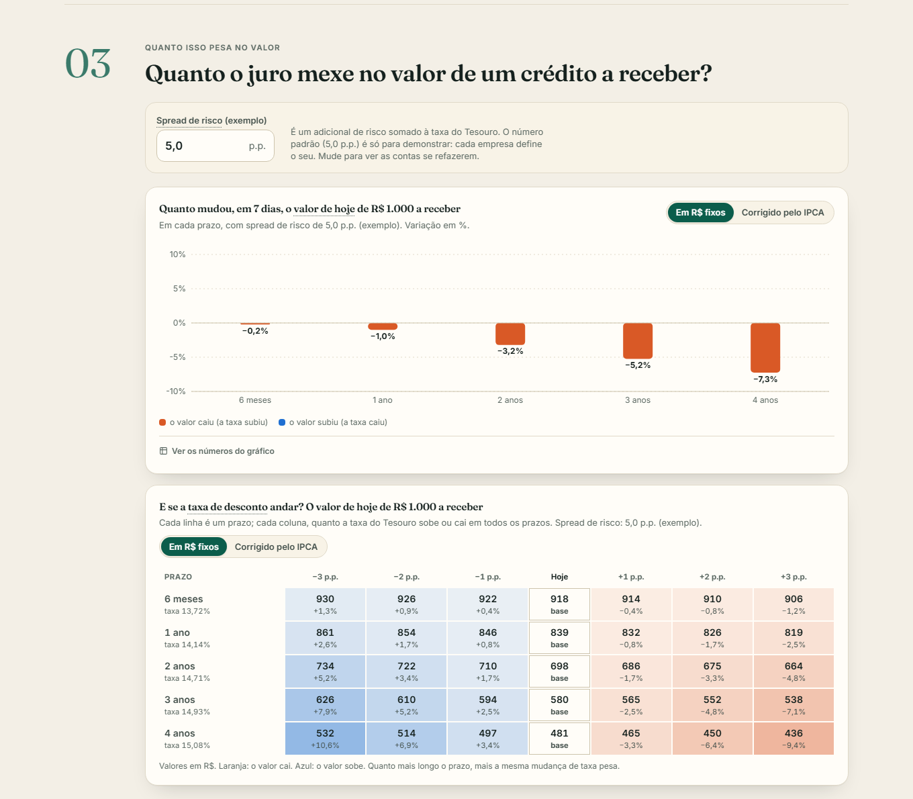
<br><br>
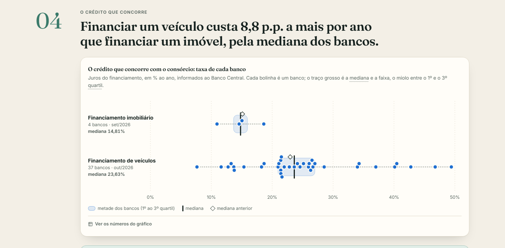
<br><br>
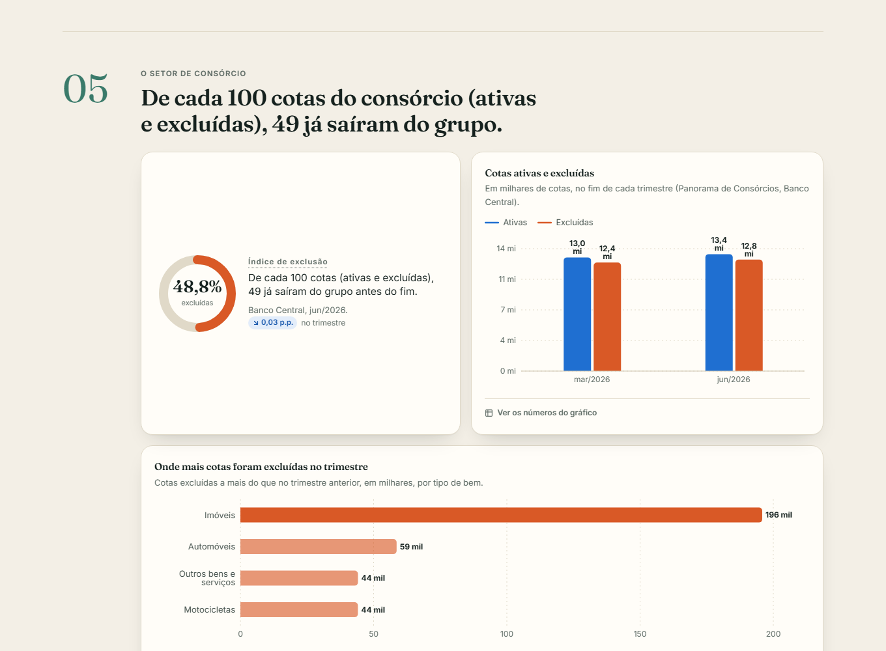
<br><br>
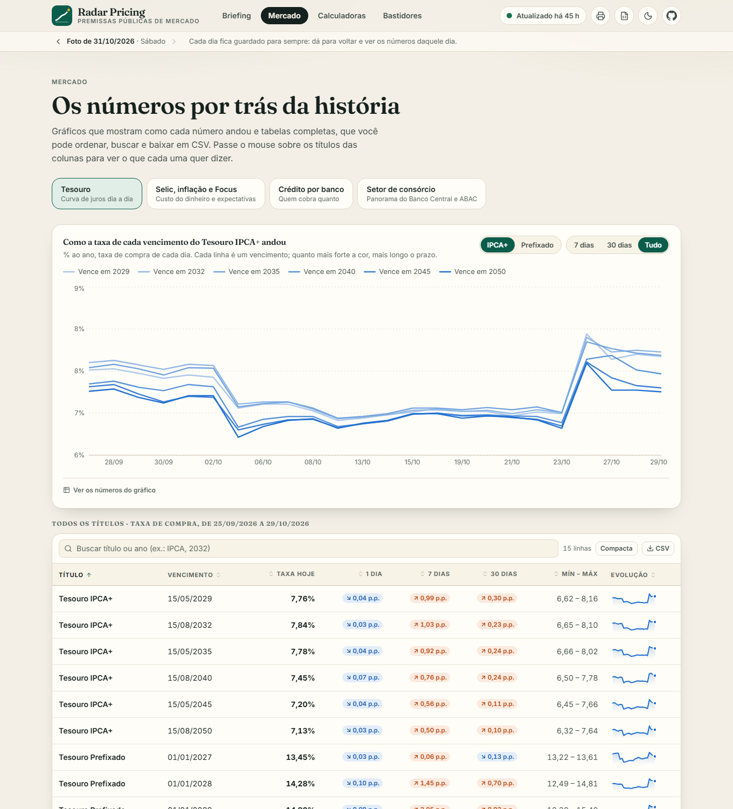
<br><br>
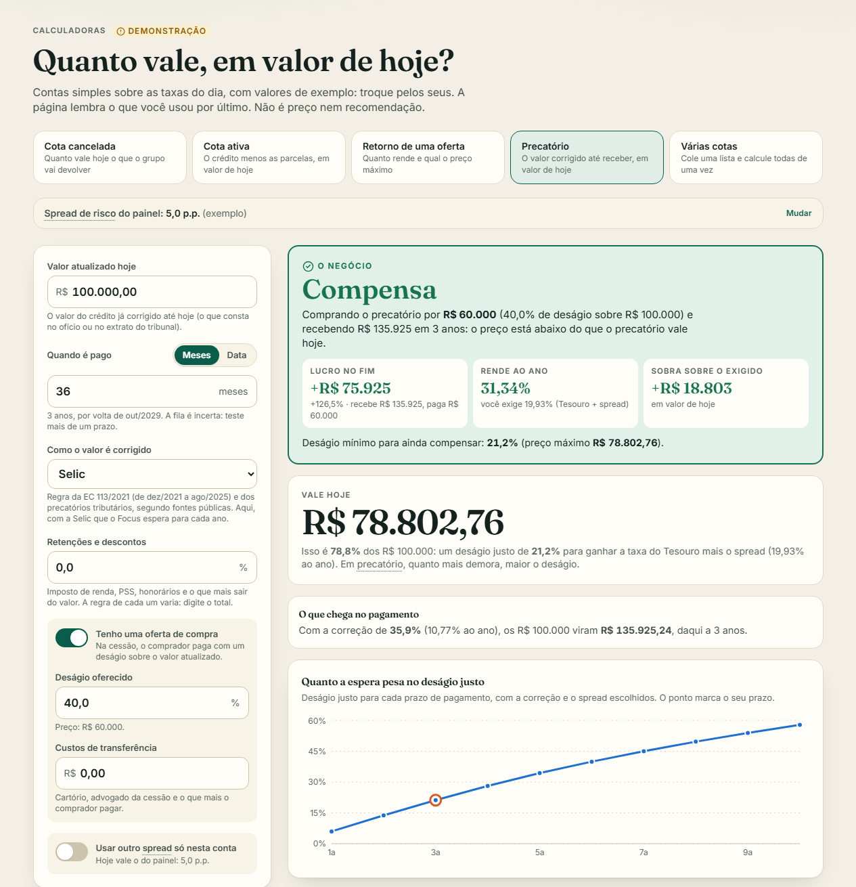
<br><br>
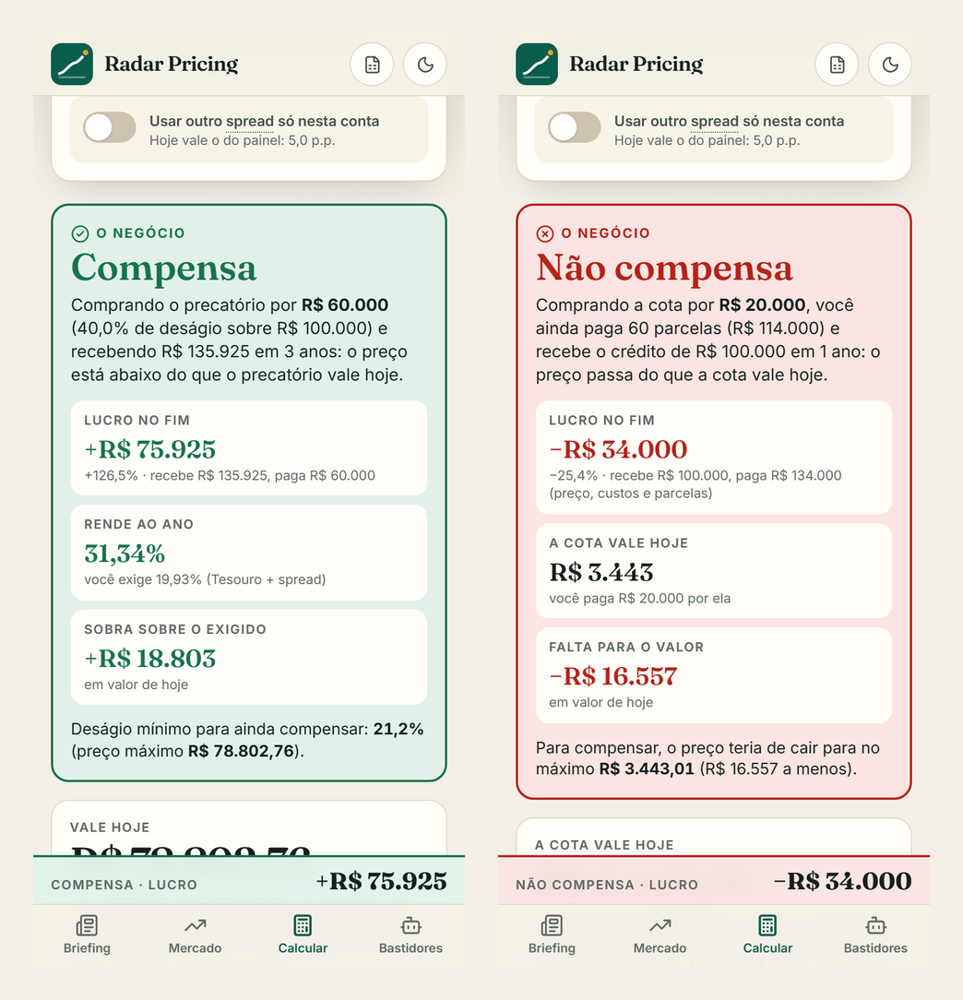
<br><br>
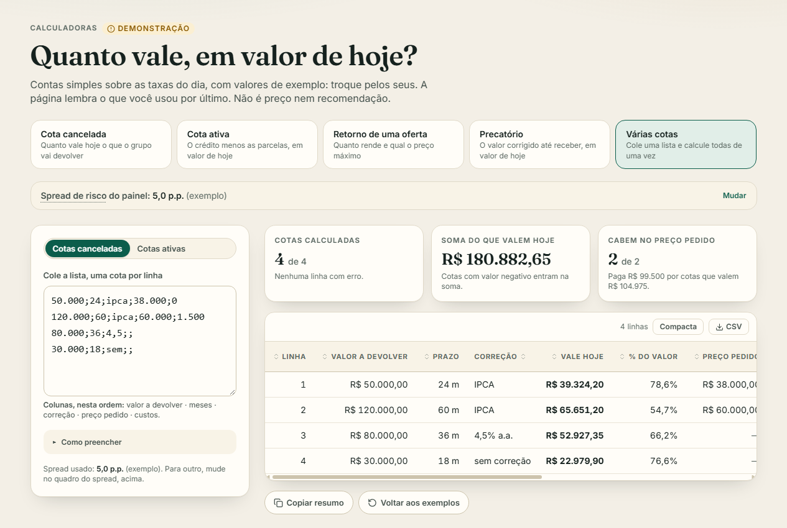
<br><br>
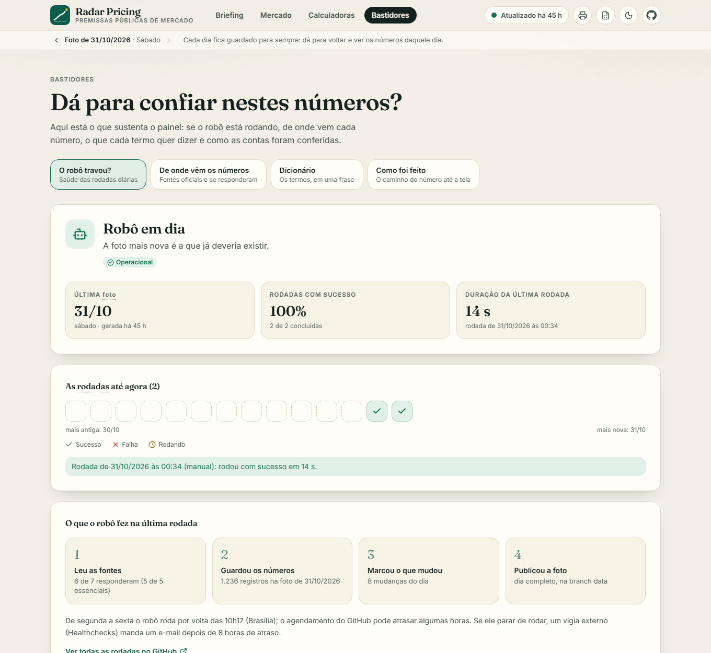
<br><br>
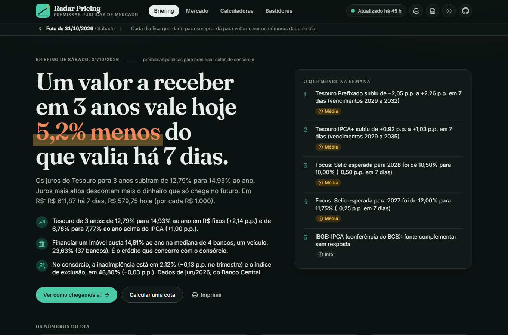
</div>

---

## 🧩 O Que Tem Em Cada Tela

| Tela | O que mostra |
|---|---|
| **Briefing** | A manchete do dia, os números do dia (valor, mudança em 7 dias, linha do tempo, fonte e data), o que mexeu na semana e cinco capítulos: **1** custo do dinheiro (Selic, CDI e o que o Focus espera), **2** curva de juros do Tesouro (hoje, 7 e 30 dias atrás), **3** quanto isso pesa no valor (variação por prazo e tabela de sensibilidade), **4** crédito concorrente (a taxa de cada banco) e **5** o setor (índice de exclusão, inadimplência, vendas da ABAC) |
| **Mercado** | Quatro abas com gráficos e tabelas completas: Tesouro, Selic e inflação e Focus, crédito por banco e setor de consórcio |
| **Calculadoras** | Cota cancelada (corrigida pela inflação, por uma taxa que você informa ou sem correção), cota ativa (crédito menos parcelas, por mês de contemplação), retorno de uma oferta (com preço máximo para um retorno desejado e custos de transferência), precatório (valor corrigido até receber, com a escolha do índice, retenções e a oferta de compra) e **várias cotas**: você cola uma lista copiada do Excel e vê quanto vale cada uma, quais cabem no preço pedido e baixa o resultado em CSV. As quatro primeiras trazem "e se?" e "como foi calculado" |
| **Bastidores** | O robô travou? (veredito e tira das últimas 14 rodadas), de onde vêm os números (cada fonte e se respondeu), dicionário de 19 termos e como foi feito |

## 🔄 Como Funciona

Três partes que não se falam diretamente: o **robô** (Python, no GitHub Actions), a **branch `data`** (uma foto por dia) e o **painel** (React, no navegador de quem abre). O painel só *lê* arquivos; o robô nem sabe que ele existe.

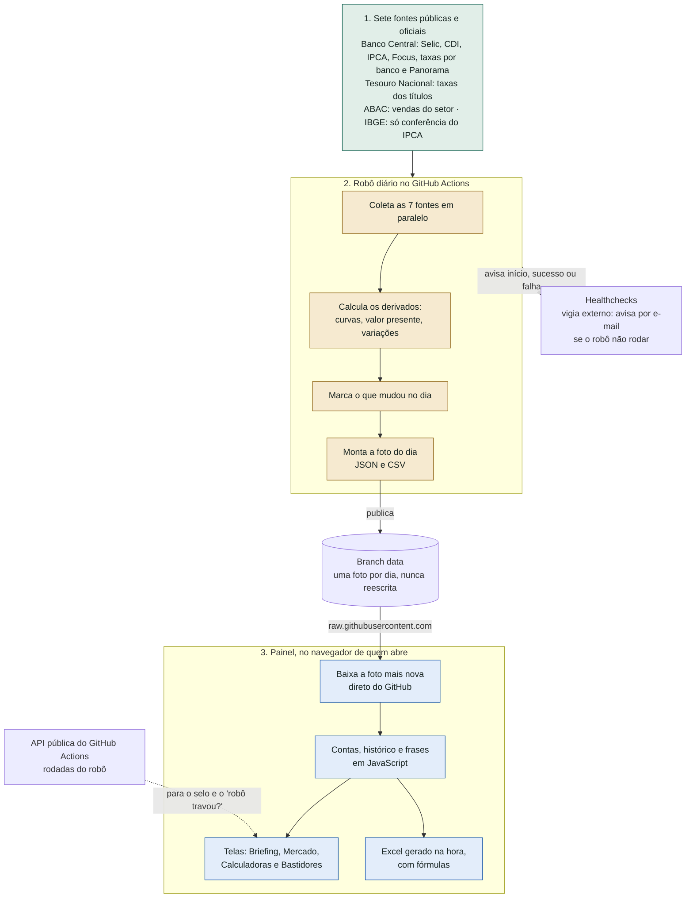

**Por que o painel não é refeito a cada coleta.** O robô grava na branch `data` com o `GITHUB_TOKEN`, e um envio feito com esse token não dispara outros workflows. Se o site precisasse ser publicado de novo a cada coleta, o robô não conseguiria fazer isso sozinho. Do jeito que está, o site só é publicado quando eu mudo a página.

### A rodada diária, passo a passo

De segunda a sexta, 10h17 de Brasília ([`coleta-diaria.yml`](.github/workflows/coleta-diaria.yml)). Uma fonte que cai não derruba as outras, o dia parcial é publicado de qualquer jeito (com o aviso do que faltou) e uma foto publicada nunca é alterada.

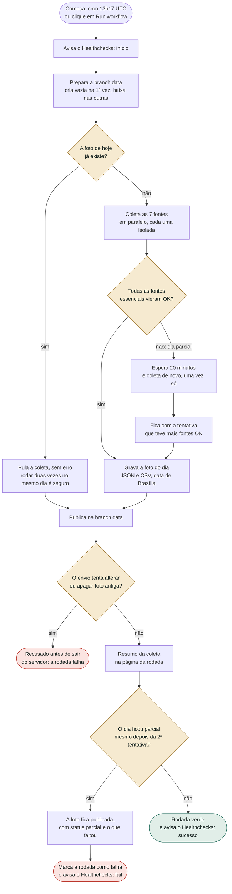

**Os outros fluxogramas** estão em [`docs/fluxograma.md`](docs/fluxograma.md): dentro da coleta (da fonte à foto), como o painel acha e usa a foto, como o número do dia é calculado, como o painel decide "o robô travou?" e como o código vira site (testes e publicação).

---

## 📚 De Onde Vêm os Números

Todas as fontes são públicas e oficiais. Cada uma foi testada com chamada de verdade, e os defeitos que achei (são 16) estão em [`docs/fontes_de_dados.md`](docs/fontes_de_dados.md).

| Fonte | Papel | O que traz | Frequência |
|---|---|---|---|
| **Banco Central, SGS** | essencial | Meta Selic, Selic over, CDI, Selic do mês anualizada, IPCA mensal e em 12 meses | diária (IPCA mensal) |
| **Banco Central, Focus** | essencial | Mediana das projeções de Selic e IPCA por ano e da Selic por reunião do Copom | uma linha por dia útil |
| **Banco Central, taxas de juros** | essencial | Taxa de financiamento imobiliário e de veículos, por banco | mensal e semanal |
| **Banco Central, Panorama de Consórcios** | essencial | 125 métricas do setor: cotas ativas e excluídas, inadimplência, taxa de administração, prazo e valor médios | trimestral |
| **Tesouro Transparente** | essencial | Taxa de compra e de venda de todos os títulos do Tesouro Direto | diária |
| **ABAC** | complementar | Vendas e contemplações do setor no ano, tíquete médio | mensal |
| **IBGE** | complementar | Conferência do IPCA do Banco Central | mensal |

*Essencial* quer dizer que, se a fonte falta ou está atrasada, o dia sai como "parcial" (a foto é publicada com o aviso do que faltou). *Complementar* pode faltar sem estragar o dia.

## 🧮 As Contas (Em Português)

* **Prazo.** Conto como o Tesouro conta: **dias úteis** (segunda a sexta, sem os feriados nacionais), do dia seguinte à data-base da curva até a data do pagamento, **divididos por 252**. A data do pagamento é o mesmo dia do mês, N meses depois. Conferi com o preço que o próprio Tesouro publica (5 vencimentos do Prefixado, 30/10/2026): contando assim o erro é de 0,001%, menos de um centavo em R$ 1.000. Contando dias corridos ÷ 365,25, como eu fazia, o painel descontava demais, de 0,12% a 0,59%.
* **Taxa para um prazo qualquer.** Interpolação linear entre os dois vencimentos vizinhos do Tesouro, com o prazo de cada vencimento contado do mesmo jeito (dias úteis ÷ 252).
* **Valor de hoje de um valor a receber** = valor ÷ (1 + taxa de desconto) elevado ao prazo em anos de 252 dias úteis. A taxa de desconto é a taxa do Tesouro para o prazo mais o *spread* de risco. Se o valor é corrigido pela inflação, a conta usa a curva IPCA+ e o resultado fica em reais de hoje.
* **Mudança em 7 dias.** A mesma conta com a curva de uma semana antes (o robô guarda a taxa de 7 dias atrás de cada vencimento): a diferença é o efeito da semana.
* **Retorno de uma oferta** = (valor a receber ÷ preço) elevado a (1 ÷ prazo em anos úteis) − 1. **Preço máximo** = valor a receber ÷ (1 + retorno desejado) elevado ao prazo em anos úteis. O que segue um índice por calendário (a correção mês a mês do precatório e a taxa própria de correção) continua em meses corridos, 1 mês = 1/12 de ano.
* **Cota ativa** = o crédito descontado até o mês da contemplação, menos todas as parcelas descontadas.
* **O veredito** (**Compensa**, **No limite**, **Não compensa**) = o *lucro no fim* (o que entra menos o que sai do bolso, sem descontar) ao lado do *quanto sobra ou falta sobre o retorno exigido* (o valor de hoje do que entra menos o que sai hoje). Vermelho quando falta, amarelo quando sobra menos de 5%, verde daí para cima. Pode haver lucro em reais e mesmo assim "Não compensa", porque rende menos que o Tesouro mais o spread.
* **Cota cancelada com taxa própria** = o valor de hoje cresce à taxa que você informar (o índice do bem, como INCC ou tabela FIPE) até a data e depois desconta pela curva Prefixada mais o spread, porque a correção já embute a inflação.
* **Várias cotas** = a mesma conta de cada calculadora, linha por linha, sobre a lista que você colar; nada de conta nova.
* **Precatório** = o valor corrigido mês a mês até o pagamento (multiplicando o fator de cada mês, que vem da Selic ou do IPCA que o Focus espera para aquele ano), menos as retenções que você informar, descontado pela curva Prefixada do Tesouro mais o *spread*. O índice de correção é uma escolha sua (Selic, IPCA mais juros limitado pela Selic, taxa própria ou sem correção), porque a regra mudou em 2025 e a transição é discutida: a calculadora mostra a conta e não diz qual vale para o seu caso. O resultado é o valor de hoje e o *deságio justo* (quanto abaixo do valor atualizado o preço teria de ficar para quem compra ganhar o Tesouro mais o spread). Com uma oferta de compra, mostra também o retorno ao ano de quem compra, o *deságio mínimo* e o preço máximo, já separando os custos.
* **Índice de exclusão** = cotas excluídas ÷ (ativas + excluídas). Confere com o que o Banco Central publica (48,8% em jun/2026).

O que as calculadoras **não** consideram: a chance de ser contemplada, lance, seguro, fundo de reserva, as regras de cada grupo e o risco de a administradora atrasar; no precatório, também a ordem da fila, o imposto de cada caso e o risco de o ente atrasar o pagamento. Detalhes e limites em [`docs/painel.md`](docs/painel.md).

## ✅ Como Conferi

| O quê | Como | Resultado |
|---|---|---|
| **Os números do painel** | [`scripts/audita_painel.py`](scripts/audita_painel.py) refaz as contas em Python, só com os registros brutos, e compara com o que o JavaScript calculou (roda a cada envio) | 763 números conferidos, 0 divergências, e mais 72 mil em entradas aleatórias ([relatório de 01/11](docs/auditoria/calculos_2026-11-01.md) e [segunda revisão, de 02/11](docs/auditoria/calculos_2026-11-02.md)) |
| **O dado bruto** | Comparei com as fontes oficiais baixadas de novo | 360 de 360 taxas do Tesouro iguais ao arquivo oficial; 65 valores do SGS e 16 do Focus iguais aos das APIs |
| **JavaScript contra o robô** | A calculadora do painel contra a conta do robô, com uma foto de verdade | 4.800 combinações iguais ao centavo; mais 224 combinações das três primeiras calculadoras (com a taxa própria) e 576 do precatório contra a conta refeita em Python |
| **Testes** | Node para as contas e a leitura, vitest para as telas, pytest para o robô e para a conversa entre os dois | 161 + 51 + 156 testes, todos offline (respostas reais gravadas) |
| **O Excel** | Aberto no Excel 16 de verdade, com as fórmulas recalculadas | 5.774 fórmulas, 0 diferenças contra o painel, em 16 cenários |
| **Os testes pegam erro?** | Estraguei o código de propósito, uma coisa por vez | 53 vezes no robô, 193 no painel, no Excel e na auditoria: todas acabaram percebidas (algumas só na segunda tentativa, e cada uma ganhou um teste) |
| **A nuvem** | A rodada de verdade no GitHub Actions, o site publicado e o `npm audit` | verde; 0 vulnerabilidades conhecidas nas dependências |

## 🧱 Tecnologias

| Parte | O que usei |
|---|---|
| **Robô** | Python 3.13, só biblioteca padrão (nada para instalar); GitHub Actions; git (branch `data` órfã, por `git worktree`) |
| **Painel** | React 19, TypeScript, Vite, Tailwind CSS 4, Recharts (gráficos), TanStack Table (tabelas), Radix UI (balões e controles), Motion (animações), Lucide (ícones), fontes Fraunces e Inter no próprio site |
| **Contas, leitura e Excel** | JavaScript simples em [`site/js/`](site/js), com o gerador de `.xlsx` escrito à mão (um zip com os XMLs que o Excel exige) |
| **Testes** | pytest, `node --test`, vitest e Testing Library, ruff |
| **Vigia** | Healthchecks (aviso por e-mail se o robô não rodar) |
| **Hospedagem** | GitHub Pages para o painel; branch `data` do GitHub para as fotos |

As dependências do painel têm versão exata, só versões com mais de 14 dias de publicadas, e o CI instala com `npm ci --ignore-scripts`. O site declara uma política de conteúdo fechada (só scripts, estilos e fontes do próprio site) e só se conecta ao `raw.githubusercontent.com` e à API do GitHub.

## 🗂️ Estrutura

```
src/radar_pricing/      o robô: http.py (cliente), fontes/ (7 coletores), coleta.py, derivados.py,
                        prazo.py (dias úteis, base 252), mudancas.py, historico.py, foto.py, dados_branch.py, __main__.py
site/                   o painel
  js/                   contas, leitura da foto, frases e Excel (JavaScript simples)
  src/                  telas (Briefing, Mercado, Calculadoras, Bastidores), gráficos e componentes
  tests/                161 testes de contas e leitura, com a foto real em tests/fixtures
scripts/                verifica_fontes.py (testa cada fonte de verdade), audita_painel.py,
                        confere_excel.py (abre o Excel de verdade, no Windows), grava_amostras.py
tests/                  156 testes em Python, com respostas reais gravadas
docs/                   fluxograma.md, painel.md, robo_diario.md, fontes_de_dados.md, auditoria/
config.toml             papel de cada fonte e parâmetros de exemplo
.github/workflows/      coleta-diaria.yml, ci.yml, pages.yml, verifica-fontes.yml
```

## ▶️ Rodar No Seu Computador

Precisa de Python 3.11 ou mais novo e, para o painel, Node 22.

```bash
# o robô (não precisa instalar nada além do pacote)
python -m pip install -e ".[dev]"
python -m radar_pricing coletar                 # coleta e grava a foto do dia em data_local/
python -m radar_pricing coletar --sem-gravar    # só mostra o resultado
python -m pytest                                # os testes em Python
python scripts/audita_painel.py site/tests/fixtures/foto-2026-10-31.json

# o painel
cd site
npm ci
npm run dev                                     # abre em http://localhost:5173
npm test                                        # contas e leitura (Node) e telas (vitest)
npm run build
```

Para ler fotos locais em vez das da branch `data`, abra o painel com `?base=` apontando para a pasta (só funciona em `localhost`: no site publicado a origem dos números é fixa).

## ⚠️ Limitações

* **É uma demonstração.** O spread de risco e os valores das calculadoras são de exemplo. Preço de verdade depende de extratos, regras e histórico que só uma empresa tem; não encontrei fonte pública de preço de cota no mercado secundário, nem de valor e credor de precatório. O painel acompanha as **premissas**, não o preço.
* **O robô tem um dia de vida na nuvem.** A primeira rodada agendada é a de 02/11/2026. O GitHub pode atrasar o agendamento em horas (por isso o painel dá 6 horas de folga antes de dizer que o robô atrasou) e, segundo a documentação do GitHub, desliga agendamentos de repositório público depois de 60 dias sem atividade. O vigia externo (Healthchecks) existe para isso, mas o e-mail de alerta ainda não foi provado de verdade.
* **O histórico dos gráficos é o que cada foto traz:** cerca de 5 semanas de Tesouro e 2 meses de Selic. Uma linha do tempo mais longa só faz sentido depois de semanas de fotos.
* **O IBGE não responde** a partir dos servidores do GitHub. Ele só serve de conferência do IPCA do Banco Central.
* **Testei o painel só em navegador Chromium** (claro e escuro, em tela larga e simulando celular de 320, 375 e 768 px, sem rolagem lateral em 13 telas). Não testei em um celular de verdade, nem no Safari ou Firefox, nem com leitor de tela. A impressão tem o estilo escrito, mas não conferi o PDF.
* **O Excel** foi aberto no Excel 16 do Windows; não abri no Mac, no Excel Online nem no LibreOffice.

## 🛣️ Próximos Passos

* Provar o alerta de "robô parado" de ponta a ponta e acompanhar as primeiras semanas de rodadas agendadas.
* Uma linha do tempo mais longa, juntando as fotos guardadas, quando houver semanas de histórico.

## 📄 Licença

[MIT](./LICENSE). Feito por [Victor Ozores](https://github.com/victor-ozores). Usei o Claude Code como ferramenta de desenvolvimento; as decisões, as conferências e o que está escrito aqui são minhas.
