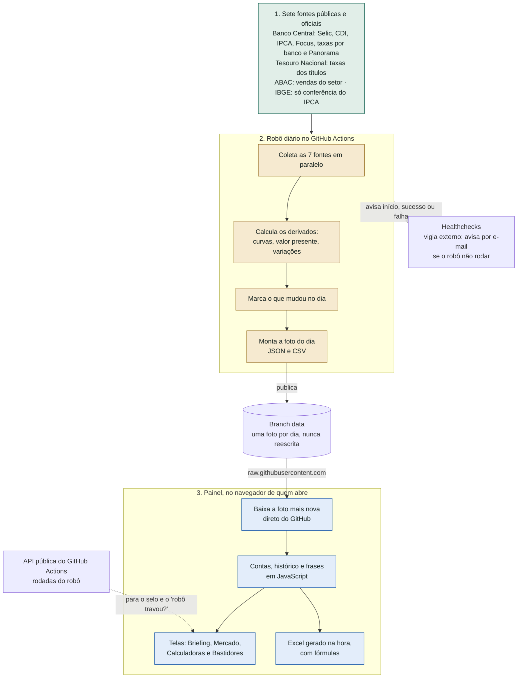
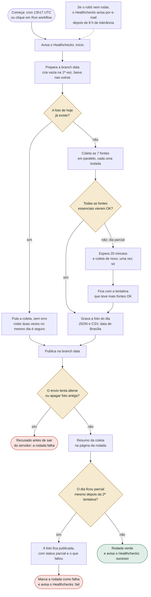
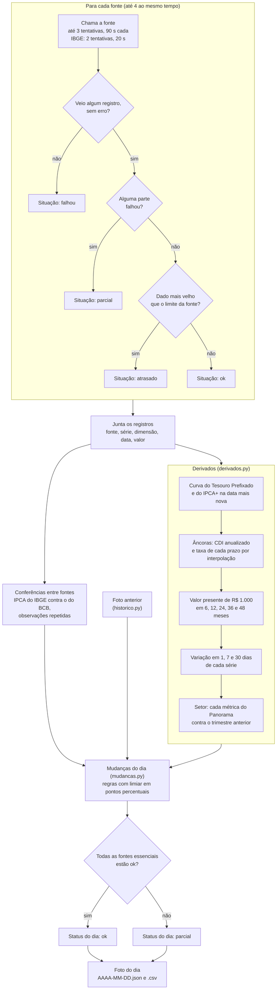
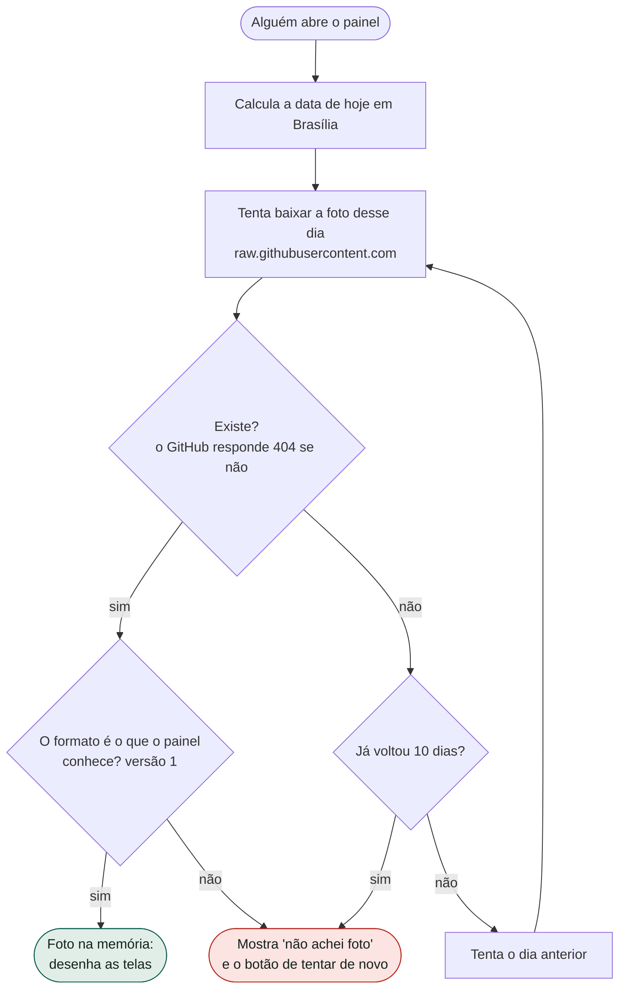
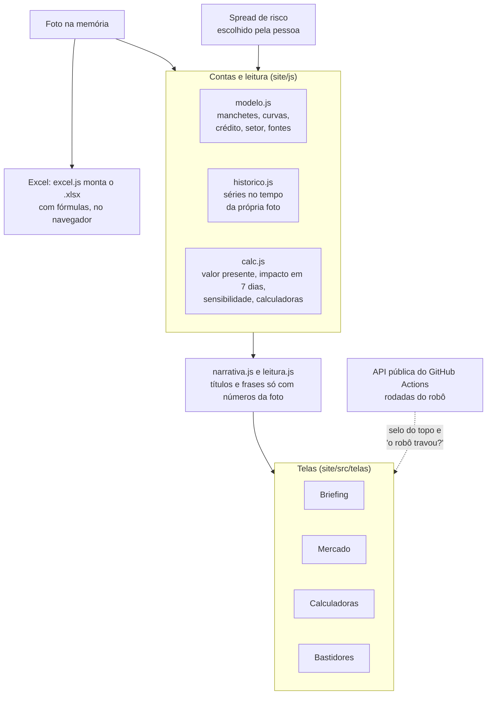
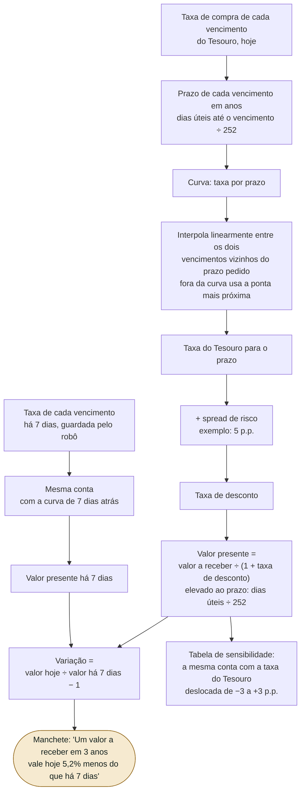
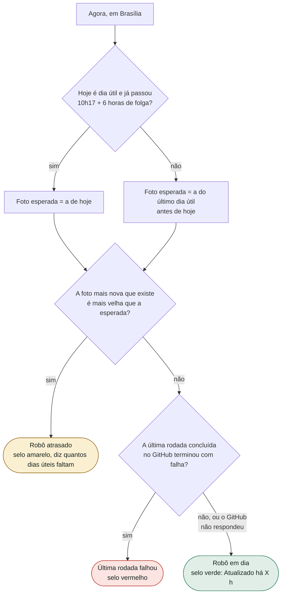
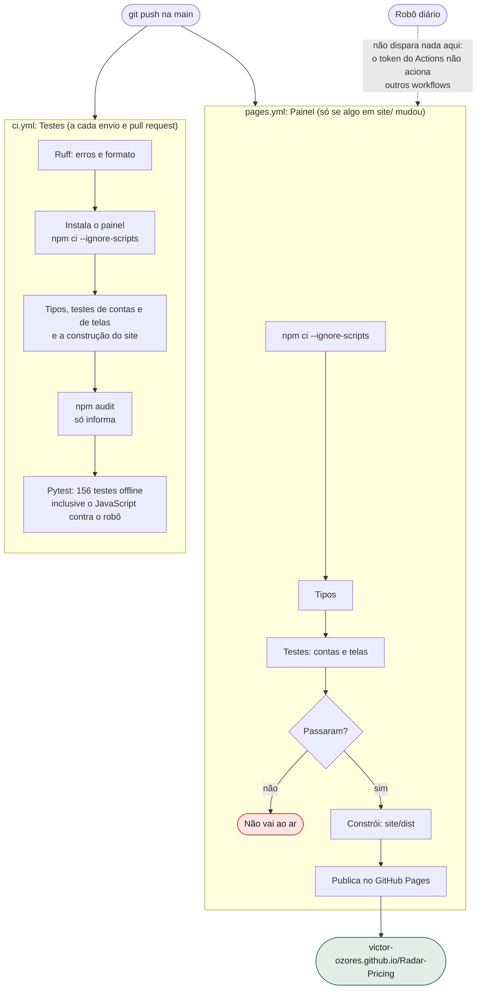

# Fluxogramas do Radar Pricing

Aqui está o caminho completo, do dado público até o número na tela. Cada desenho confere com o código: o nome do arquivo que faz cada passo está nas legendas. Os desenhos são em [Mermaid](https://mermaid.js.org/), que o GitHub mostra direto na página.

1. [Visão geral](#1-visão-geral)
2. [A rodada diária do robô](#2-a-rodada-diária-do-robô)
3. [Dentro da coleta: da fonte à foto](#3-dentro-da-coleta-da-fonte-à-foto)
4. [A foto no navegador: do arquivo à tela](#4-a-foto-no-navegador-do-arquivo-à-tela)
5. [O número do dia: como o valor de hoje é calculado](#5-o-número-do-dia-como-o-valor-de-hoje-é-calculado)
6. [O robô travou? Como o painel decide](#6-o-robô-travou-como-o-painel-decide)
7. [Do código ao site: testes e publicação](#7-do-código-ao-site-testes-e-publicação)

---

## 1. Visão geral

Três partes que não se falam diretamente: o **robô** (Python, roda no GitHub Actions), a **branch `data`** (onde ficam as fotos, uma por dia) e o **painel** (React, roda no navegador de quem abre). O painel só *lê* arquivos; o robô nem sabe que o painel existe.

**Por que assim.** O robô grava na branch `data` com o `GITHUB_TOKEN`, e um envio feito com esse token **não dispara outros workflows**. Se o site precisasse ser publicado de novo a cada coleta, o robô não conseguiria fazer isso sozinho. Do jeito que está, o site só é publicado quando eu mudo a página.

---

## 2. A rodada diária do robô

Arquivo: [`.github/workflows/coleta-diaria.yml`](../.github/workflows/coleta-diaria.yml). Roda de segunda a sexta às 10h17 de Brasília (13h17 UTC) e também à mão.

O que o desenho mostra de importante: **uma fonte que cai não derruba as outras**, **o dia parcial é publicado de qualquer jeito** (com o aviso do que faltou) e **uma foto publicada nunca é alterada**.

---

## 3. Dentro da coleta: da fonte à foto

Arquivos: [`src/radar_pricing/coleta.py`](../src/radar_pricing/coleta.py), [`derivados.py`](../src/radar_pricing/derivados.py), [`mudancas.py`](../src/radar_pricing/mudancas.py), [`foto.py`](../src/radar_pricing/foto.py).

**Papel de cada fonte** (arquivo [`config.toml`](../config.toml)): *essenciais* são BCB SGS, Focus, taxas de crédito, Panorama e Tesouro; *complementares* são IBGE e ABAC. Se uma essencial falta ou está atrasada, o dia sai parcial; se uma complementar falta, o dia continua ok e o painel só diz que ela não respondeu.

---

## 4. A foto no navegador: do arquivo à tela

Arquivos em [`site/`](../site): `js/foto.js` (busca), `src/dados.tsx` (estado), `js/modelo.js`, `js/historico.js`, `js/calc.js`, `js/leitura.js`, `js/narrativa.js` (contas e frases) e `src/telas/` (telas).

**4a. Como o painel acha a foto.** Hoje de manhã a foto de hoje ainda pode não existir (fim de semana, feriado, robô atrasado), então ele volta dia a dia.

**4b. O que ele faz com a foto.** Nada é calculado no servidor: as contas, o histórico e as frases saem da foto, no navegador.

O **spread de risco** (5 p.p. de exemplo) é uma premissa só: trocar em uma tela refaz as contas em todas.

---

## 5. O número do dia: como o valor de hoje é calculado

Arquivo: [`site/js/calc.js`](../site/js/calc.js) (`interpola`, `valorPresente`, `impactoNoPrazo`). A mesma conta está escrita em Python em [`derivados.py`](../src/radar_pricing/derivados.py) e [`prazo.py`](../src/radar_pricing/prazo.py) (a contagem de dias úteis, também em [`prazo.js`](../site/js/prazo.js)), e um teste compara as duas ao centavo.

**Convenções** (iguais no JavaScript, no Python e no Excel): taxa efetiva ao ano, capitalização composta, prazo em dias úteis (sem fins de semana nem feriados nacionais) ÷ 252, contado da data-base da curva até o mesmo dia do mês, N meses depois. O que segue um índice por calendário (a correção do precatório, a taxa própria) fica em meses corridos, 1 mês = 1/12 de ano. Valor corrigido pela inflação usa a curva **IPCA+** e o resultado fica em reais de hoje; valor sem correção usa a curva **Prefixada**.

---

## 6. O robô travou? Como o painel decide

Arquivo: [`site/js/saude.js`](../site/js/saude.js). O robô roda de segunda a sexta às 10h17; o GitHub pode atrasar o agendamento em algumas horas, por isso o painel dá 6 horas de folga antes de reclamar.

Se o GitHub não responder, o veredito vale só pela foto, e a tela diz que não conseguiu ver o histórico das rodadas. O Healthchecks (e-mail se o robô nem rodar) não aparece aqui: o painel não enxerga esse vigia.

---

## 7. Do código ao site: testes e publicação

Arquivos: [`ci.yml`](../.github/workflows/ci.yml) e [`pages.yml`](../.github/workflows/pages.yml).

Outro fluxo, **fora** do CI: [`scripts/verifica_fontes.py`](../scripts/verifica_fontes.py) testa cada fonte com chamada de verdade (workflow `verifica-fontes.yml`, só à mão), e [`scripts/confere_excel.py`](../scripts/confere_excel.py) abre o Excel de verdade no meu Windows para conferir as fórmulas.
